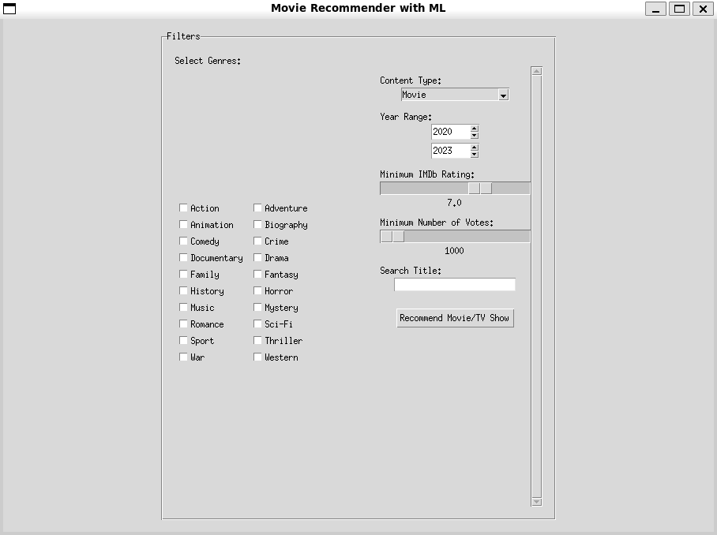
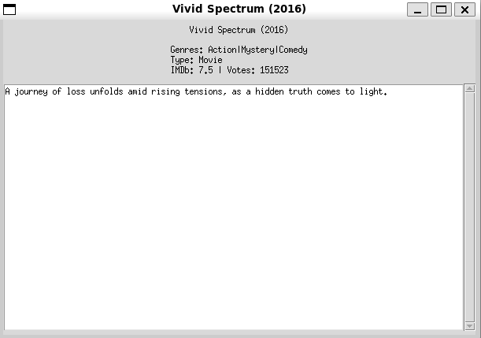

# Movie Recommender System

A desktop movie and TV show recommendation system built with Python and machine learning techniques.

The application allows users to filter movies and TV shows based on their preferences and recommends similar titles using user-rating patterns and cosine similarity.

## Screenshots

### Main Application



### Recommendation Result



## Features

- Recommend movies and TV shows
- Filter by genre
- Filter by content type (Movie or TV Show)
- Select a release year range
- Set a minimum IMDb rating
- Set a minimum number of ratings
- Search for titles
- Generate recommendations based on user-rating similarity
- Desktop graphical interface built with Tkinter

## How It Works

The system combines preference-based filtering with collaborative recommendation.

First, the application filters the dataset according to the user's selected criteria, including genre, content type, release year, IMDb rating, number of ratings, and title search.

The recommendation component uses a user-rating matrix and cosine similarity to identify titles with similar rating patterns.

## Technologies

- Python
- Pandas
- NumPy
- scikit-learn
- Tkinter
- Cosine Similarity

## Project Structure

```text
movie-recommender-system/
├── data/
│   ├── movie_columns_map.csv
│   ├── movies_1000_en.csv
│   └── user_ratings.csv
├── screenshots/
│   ├── app-main.png
│   └── recommendation-result.png
├── src/
│   ├── data_loader.py
│   ├── filters.py
│   ├── gui.py
│   ├── main.py
│   ├── recommender.py
│   └── utils.py
├── .gitignore
├── README.md
└── requirements.txt
```

## Installation

Clone the repository and enter the project directory:

```bash
git clone <repository-url>
cd movie-recommender-system
```

Create a virtual environment:

```bash
python -m venv .venv
```

Activate it on Linux or WSL:

```bash
source .venv/bin/activate
```

On Windows:

```powershell
.venv\Scripts\activate
```

Install the dependencies:

```bash
pip install -r requirements.txt
```

## Running the Application

```bash
python src/main.py
```

## Recommendation Approach

The recommendation system uses item-based collaborative filtering with cosine similarity.

It compares rating patterns between titles using the user-rating matrix and selects a similar title that also satisfies the user's active filters.

## Author

**Fatemeh Sadeghi**

Bachelor's Project in Computer Science
